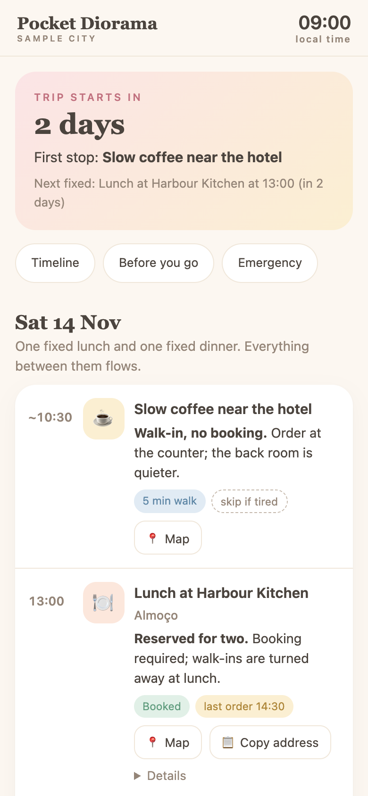
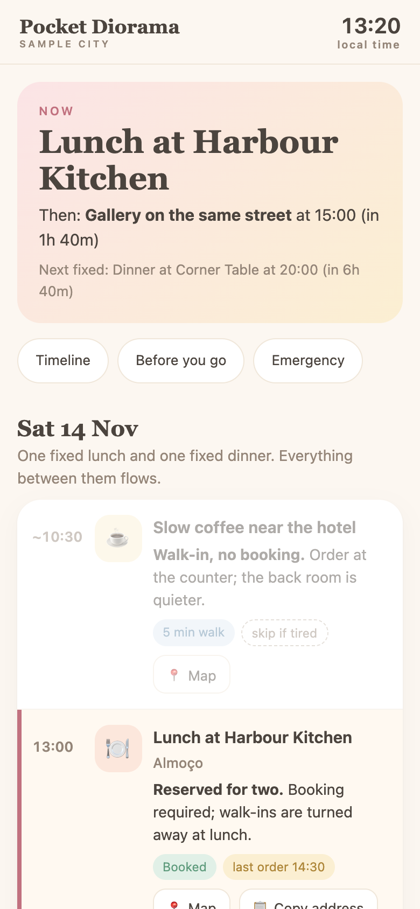
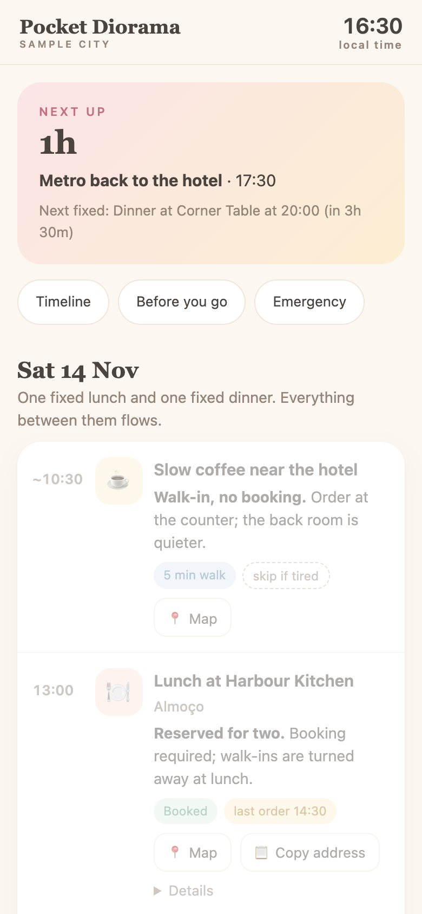

# 🧭 Pocket Diorama

> Turn any itinerary into a calm, glanceable trip companion that fits in your pocket - so you can stop worrying about the day and look up at the city.

A map gives you routes. It does not tell you what the street will feel like, what to do when the train is cancelled, or which door is the real hotel entrance. **Pocket Diorama** is a Claude skill that builds the missing layer: a single-file mobile web page where your bookings and plans become a narrated, live miniature of the day.

<table>
  <tr>
    <td align="center"><br><sub><b>Before</b> - countdown to the first stop</sub></td>
    <td align="center"><br><sub><b>Now</b> - what is happening, what is next</sub></td>
    <td align="center"><br><sub><b>Between</b> - how long until the next stop</sub></td>
  </tr>
</table>

## What you get

- **A live Now / Next hero.** It always answers: where am I in the day, what is next, and what is the next thing that cannot move.
- **A timeline that only puts a clock on real bookings.** Everything else flows, with a soft `~time` and a reason, so one delay does not break the day.
- **A failure plan on every stop.** The fallback, what it costs, and when to trigger it.
- **Show-the-driver address cards** in the local script, with a copy button.
- **Judgment over listings.** What to skip, numbers instead of adjectives, two good options instead of twelve.
- **Honest confidence.** Anything not verified for that exact weekday is flagged, and the page ends with a dated "checked on" footer.
- **Carry-able.** One HTML file, system fonts, no login, no tracking, `noindex`, and a tiny service worker so it reloads even with no signal.

## Install

As a Claude Code plugin marketplace:

```
/plugin marketplace add 3243dwon/pocket-diorama
/plugin install pocket-diorama@pocket-diorama
```

Or copy the single skill file into your own skills folder:

```bash
mkdir -p ~/.claude/skills/pocket-diorama
curl -fsSL https://raw.githubusercontent.com/3243dwon/pocket-diorama/main/skills/pocket-diorama/SKILL.md \
  -o ~/.claude/skills/pocket-diorama/SKILL.md
```

## Use it

Just describe the trip. The skill triggers on things like:

- "Turn this itinerary and these booking emails into a page I can follow on my phone."
- "I land at 15:20 and have dinner booked at 20:00. Make me a one-day plan I can actually use."
- "I get anxious in unfamiliar cities. Build me a what-do-I-do-right-now guide for this trip."

It will collect what it needs in one batch, work backwards from your hardest booking to find the real slack, verify opening hours for the actual weekday, and hand back a single `index.html` plus a short list of assumptions, unverified items and deadlines.

## Four shapes, one engine

| Shape | Best for |
|---|---|
| **Editorial Scroll** | Multi-day, multi-city trips read the night before |
| **Flexible Day** | One-day city itinerary with a few bookings |
| **24-Hour Carry** | Layovers and short stopovers |
| **Quiet Multi-Day** | A few days in one city, shopping and food heavy |

All four share the same data model, the same chip vocabulary and the same live hero. The skill includes a complete reference engine, three themes, a verification checklist and a privacy checklist.

## Privacy by default

An itinerary reveals when someone is away from home and where they sleep. The skill writes "booked - reference in your email" instead of printing booking codes, keeps progress marks on the device only, adds `noindex`, and runs a scan for codes and phone numbers before anything is published.

## Test the engine yourself

The reference engine in `SKILL.md` has a time-travel switch. Save it as `index.html`, open it, and append `?at=2026-11-14T13:20` to see the page as it would look at that moment at the destination.

## License

MIT
